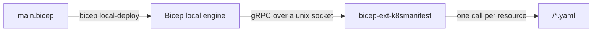

# bicep-ext-k8smanifest — how it works

> The [root README](../README.md) covers the quickstart and why the project
> exists; this document explains how the extension works and how the
> repository is put together.

[](../LICENSE)

A custom **Bicep Local extension** written in Go that turns Kubernetes
manifests authored in Bicep into standalone YAML files. **Nothing is
deployed to any cluster** — the deploy step belongs to your GitOps tooling
(e.g. [Flux](https://fluxcd.io/)) or a manual `kubectl apply`.

## How it works



- The Bicep file declares `targetScope = 'local'` and
  `extension k8smanifest with { outputDir: ..., combine: ... }`
  (`outputDir` defaults to `manifests`, relative to the CLI working
  directory); `bicepconfig.json` maps the `k8smanifest` name to the
  extension package.
- Each `resource x '<group>/<Kind>@<version>'` body is the manifest body
  (`metadata`, `spec`, …). The extension resolves the kind to its
  `apiVersion`, validates `metadata.name` and the kind's scope (namespaced
  vs cluster-scoped), and writes the YAML document with `apiVersion`/`kind`
  added. **`apiVersion`/`kind` are never taken from the body** — they are
  derived from the resource type you declared.
- **Output layout.**
  - `combine: false` (default): one file per resource. Namespaced kinds carry
    the namespace in the file name
    (`service-acme-dev-web.yaml`, `apps-deployment-acme-dev-web.yaml`) so two
    namespaces can never collide on one file; cluster-scoped kinds omit it.
  - `combine: true`: one `combined.yaml` with `---`-separated documents,
    sorted by a kubectl/helm-style deploy priority (namespaces first,
    workloads/routes last). The order is deterministic run to run even though
    Bicep calls the extension in arbitrary order — required so a one-pass
    `kubectl apply` sees, e.g., a Namespace before the resources in it.
- **Response properties** echo the body and add `filePath`, `content` (the
  rendered YAML), `kind` and `apiVersion`, so Bicep `output`s can reference
  e.g. `deployment.filePath`.
- **IDE typing.** Resource bodies are typed from the Kubernetes API definition
  (see *Type coverage*), so the IDE shows hover descriptions, checks property
  types, and enforces required fields at compile time.

## Type coverage

The kind catalogue lives in `src/k8s/kinds.go` (53 kinds) and covers the stable
Kubernetes API — core, `apps/v1`, `batch/v1`, `networking.k8s.io/v1`,
`gateway.networking.k8s.io/v1`, `rbac.authorization.k8s.io/v1`,
`autoscaling/v2`, `policy/v1`, `storage.k8s.io/v1`,
`coordination.k8s.io/v1`, `scheduling.k8s.io/v1`, `node.k8s.io/v1`,
`certificates.k8s.io/v1`, `apiextensions.k8s.io/v1`,
`apiregistration.k8s.io/v1`, `events.k8s.io/v1`,
`flowcontrol.apiserver.k8s.io/v1` — plus CRD-based kinds the core API
definition never carries: `gateway.networking.k8s.io` (Gateway, HTTPRoute,
ReferenceGrant), `cilium.io/v2` CiliumNetworkPolicy, the
`snapshot.storage.k8s.io/v1` VolumeSnapshot trio, and an `example.com/v1`
fixture CRD that exercises the CRD typing path in the tests.

**Every catalogued kind is fully typed.** The body types are generated into
`src/gen/` by `src/cmd/gentypes` from a pinned copy of the Kubernetes OpenAPI
swagger (`swagger/swagger.json`) merged with committed CRD schemas
(`swagger/crd/`), and embedded in the binary. For each property you get:

- the API **description** — rendered on hover in the IDE;
- the **type and constraints** — string lengths, integer ranges, string enums,
  `int-or-string` unions, arrays, maps;
- **required flags** — so a missing mandatory property is BCP035 and a wrong
  type is BCP036, standard Bicep diagnostics reported by the IDE and
  `bicep build`. The API server remains the runtime backstop.

Conventions worth knowing:

- **The body is the manifest minus the envelope.** `apiVersion`/`kind` are
  added by the extension and `status` is server-managed, so none of the three
  is in the body type. The read-only response properties
  (`filePath`, `content`, `kind`, `apiVersion`) *are* in the body type, which
  is how outputs can reference e.g. `deployment.filePath`.
- **`metadata.name` is required** — except in pod/job template metadata
  (`PodTemplateSpec.metadata`, `JobTemplateSpec.metadata`), where the API
  does not require a name.
- **Un-catalogued kinds pass through.** Any `<group>/<Kind>@<version>` not in
  the catalogue compiles against a permissive fallback body
  (e.g. `example.com/MyWidget@v1alpha1` → `apiVersion: example.com/v1alpha1`)
  and emits a single, expected BCP081 warning. The fallback is writable but
  not readable, so an `existing` CRD resource fails at compile time with an
  accurate diagnostic rather than compiling and failing at runtime.
- **Regeneration is byte-stable.** `src/gen/` is committed and embedded;
  regenerating from unchanged inputs must produce byte-identical files, so
  the artifacts never flap in git. CI asserts this.

To add a kind: append a row to `k8s.Kinds` in `src/k8s/kinds.go`, and (if the
kind's schema lives in a CRD) commit its schema under `swagger/crd/` and
rebuild.

### Raw passthrough (`k8smanifest/Raw@v1`)

Some documents the typed bodies cannot express — a field the pinned API
types don't know (an alpha or feature-gated field, a CRD outside the pinned
set), a SOPS-encrypted `Secret` whose `sops` metadata block the typed schema
rejects, or a manifest produced elsewhere entirely. The reserved
`k8smanifest/Raw@v1` type emits such a document verbatim. The body is
strictly `{ document: <manifest> }` — from a file or inline:

```bicep
// from a file: hand-written YAML, another tool's output, an encrypted secret
resource fileConfig 'k8smanifest/Raw@v1' = {
  document: loadYamlContent('./app-config.yaml')
}

// or inline: `document` carries the full manifest, apiVersion/kind included
resource inlineConfig 'k8smanifest/Raw@v1' = {
  document: {
    apiVersion: 'v1'
    kind: 'ConfigMap'
    metadata: {
      name: 'app-flags'
    }
    data: {
      logLevel: 'info'
    }
  }
}
```

- `apiVersion`/`kind` come from the wrapped document (both required), not
  from the type string;
- the document's kind drives the single-file name and the combined-file
  deploy order (a raw Secret sorts before the Deployment it feeds);
- the wrapper property never leaks into the output.

The renderer still re-serialises the document (keys sorted, YAML-safe
quoting). That is safe for ciphertext-based workflows: SOPS MACs the
encrypted *values*, not the file bytes, so a re-serialised ciphertext still
decrypts. The [raw sample](../samples/bicep/raw/) exercises both input
styles.

## YAML correctness

The renderer emits deterministic YAML — 2-space indent, top-level keys in
`apiVersion`/`kind`/`metadata`/`spec` order then alphabetical — and
double-quotes any string a YAML 1.1 reader would resolve as a non-string
(`yes`, `no`, `1`, `null`, `~`, …). Kubernetes parses manifests with YAML 1.1
semantics, so an unquoted `yes` in a ConfigMap would silently become the
boolean `true`; the quoting keeps strings strings. Integral floats are emitted
as `!!int` (`replicas: 2`, never `"2"`), and `null` means "absent": null map
entries are dropped recursively, while array elements are kept intact.

## Layout

| Path | Purpose |
|------|---------|
| `src/` | Go module: `main.go` (gRPC server), `types.go` (serves the embedded type files), `manifest.go` (validation + YAML render/write), `k8s/kinds.go` (kind catalogue, shared by runtime and generator), `cmd/gentypes/` (swagger → Bicep types generator), `gen/` (generated `types.json`/`index.json`, committed and embedded via `go:embed`), `bicep.azure.com/protos/` (generated gRPC contract from Azure/bicep) |
| `swagger/` | the pinned upstream inputs the types are generated from: `swagger.json` (Kubernetes OpenAPI) and `crd/` (CRD schemas for the CRD-based kinds). Update only via the `scripts/update-*.sh` scripts |
| `samples/` | the two examples from the README — `bicep/hello/` (the typed path) and `bicep/raw/` (the raw passthrough) — with their committed generated manifests under `samples/manifests/` |
| `scripts/` | `build.sh` (generate types + build + publish the local package), `release-build.sh` (release matrix + multi-platform package) and the `update-*.sh` scripts that refresh the pinned swagger/CRD inputs from their upstream release tags |
| `docs/` | this document |
| `bin/` | built binary + published local package — build output, never committed |

## Build, test & CI

The build, test and sample-regeneration commands live in the
[README](../README.md#build--run). One addition for anyone working on the
extension:

```bash
# lint (from src/ — the config is src/.golangci.yml, found from there)
golangci-lint run ./...
```

The CI workflow (`.github/workflows/ci.yml`) gates changes on: `go vet`,
`go test -race`, a cross-compile smoke build, a coverage floor,
`golangci-lint` + `govulncheck`, an `EXT_VERSION`-stamped `scripts/build.sh`,
and a `gen/` byte-stability check.

## Deploying the output

The extension stops at the YAML files, so the deploy step is yours. Once a
cluster is reachable, check the generated manifests before applying them:

```bash
kubectl apply --dry-run=client -f samples/manifests/hello/dev/combined.yaml
```

For GitOps, commit the output directory to the repository and point your
deployer at it. With [Flux](https://fluxcd.io/), a `Kustomization`
(`kustomize.toolkit.fluxcd.io/v1`) reconciling the branch and path that holds
the generated manifests is all it takes — the combined file is already ordered
for a one-pass apply, and because the bytes are deterministic a re-run produces
an empty diff unless the Bicep input changed. That determinism is what makes
the output safe to commit: review the manifest diff in the pull request, and
Flux applies exactly what was reviewed.

## Consuming the extension

Out of the box the extension is consumed from the **local package** in
`bin/` — point `bicepconfig.json` at it, no registry needed; the
[samples' bicepconfig.json](../samples/bicep/bicepconfig.json) shows the
form.

For shared or multi-machine use, publish the extension to an OCI registry
(`bicep publish-extension --target br:<registry>/<repo>:<version>`) and
reference the `br:` URI instead. Bicep's OCI artifact support is a
**preview** feature (the `ociEnabled` experimental flag) and is
**registry-agnostic**: any OCI Distribution registry works — GHCR, ACR,
Docker Hub, Gitea, Harbor, … Consumers need the `br:` reference,
`"ociEnabled": true` in `experimentalFeaturesEnabled`, and registry
credentials (`docker login` or the `DOCKER_*` environment variables) and,
where the registry requires it, `BICEP_TRUSTED_REGISTRIES`.
`scripts/release-build.sh` builds the multi-platform set (one registry
blob serves linux/darwin/windows, amd64/arm64); the CI `publish` job runs the
same publish and verifies the result.

## Licence

Released under the [MIT License](../LICENSE), Copyright (c) 2026 lumunro.
Third-party input files and their licences are documented in the README's
[Third-party components](../README.md#third-party-components) section.
